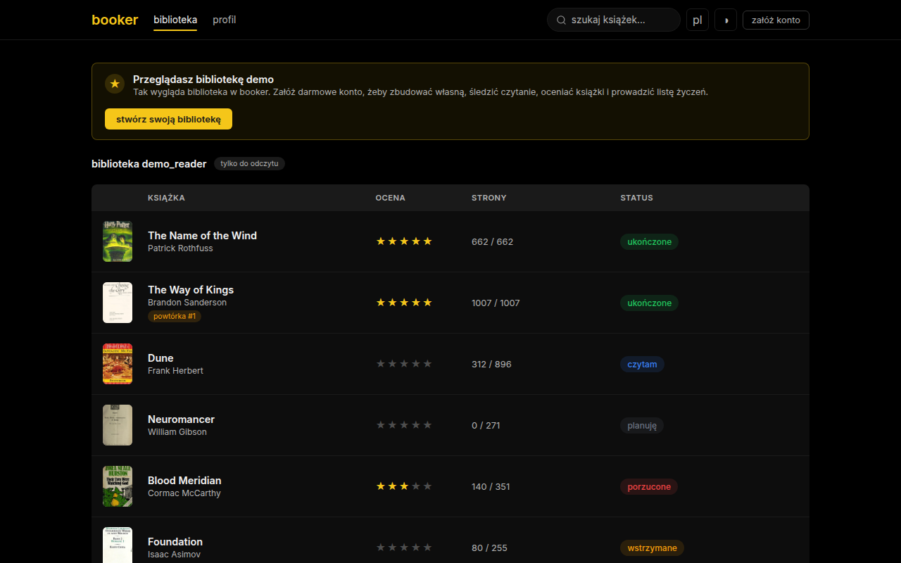
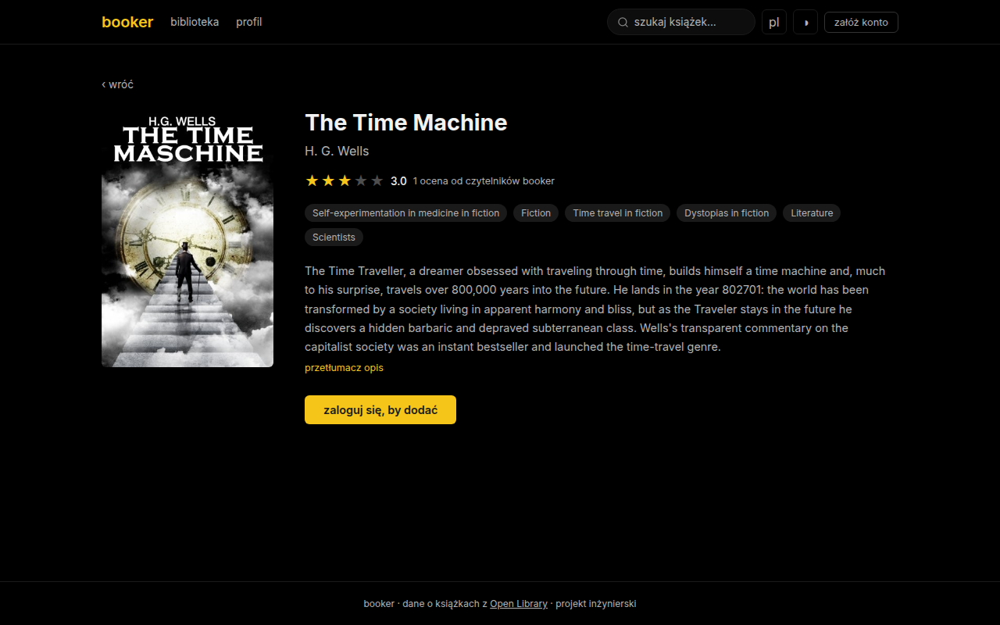

# booker

personal book‑tracking / reading‑list app, styled after MyAnimeList. python/fastapi backend + react frontend, book data from [open library](https://openlibrary.org).

thesis project.


<details>
<summary>more screenshots</summary>




</details>

## what it does

- browse genre feeds, live search, book pages with descriptions and covers
- personal library: statuses (reading / plan / completed / dropped / hold), page progress, rereads, private notes, custom books, filtering and sorting
- community ratings. the score on a card is the real average of what booker users rated that book, and if nobody here rated it yet, it falls back to open library's reader ratings. no fake numbers
- "picked for you" feed based on the subjects of books you already have
- profile stats: pages read, reading time, status breakdown, books finished per month (start/finish dates get tracked automatically), custom avatar and banner
- polish/english interface, plus on-demand description translation (mymemory)
- library export to csv/json, password change, account deletion, login rate limiting
- demo library for logged-out visitors, light/dark theme
- works on phones too: the library turns into cards on small screens, touch targets get bigger, no ios zoom jumps

## deployment

easiest way, docker builds the frontend by itself:

```sh
docker compose up -d --build    # http://localhost:8000
docker compose down
```

`--build` is only needed the first time and after code changes. day to day a plain `docker compose up -d` just starts the image you already have.

before starting, copy `.env.example` to `.env` and fill `BOOKER_SECRET_KEY` with a random value of at least 32 characters. there is no default signing key. docker compose reads `.env` automatically. to generate a key without installing python on the host:

```sh
docker run --rm python:3.12-slim python -c "import secrets; print(secrets.token_urlsafe(48))"
```

paste the output after `BOOKER_SECRET_KEY=` and keep `.env` private. the db lands in a named volume, so it survives rebuilds. for public use, put the app behind an HTTPS reverse proxy and keep the signing key stable across restarts.

on windows: install [docker desktop](https://www.docker.com/products/docker-desktop/) first (it sets up wsl2 for you), then open a regular cmd, `cd` into the project folder and run the same `docker compose up -d --build`. when windows firewall asks for permission, click allow, and make sure your wi-fi is set to "private" if you want to open the app from your phone. no python or node needed for this route.

without docker, use Python 3.12 and Node.js 22.12 or newer from the 22.x line. from a fresh checkout:

```sh
cd frontend
npm ci
npm run build
cd ../backend
python -m venv .venv
source .venv/bin/activate
python -m pip install -r requirements.txt
```

prepare `.env` in the repository root as above. with python installed, `python -c "import secrets; print(secrets.token_urlsafe(48))"` also generates a key. from `backend/`, with the virtual environment active:

```sh
uvicorn main:server --env-file ../.env --host 127.0.0.1 --port 8000
```

this serves the built frontend and the API under `/api`. on Windows, activate the virtual environment with `.venv\Scripts\activate` instead of `source`. bind to `0.0.0.0` only when access from other devices is intended.

## development

backend:

```sh
cd backend
python -m venv .venv && source .venv/bin/activate
pip install -r requirements.txt
uvicorn main:app --env-file ../.env --reload
```

frontend:

```sh
cd frontend
npm ci
npm run dev     # http://localhost:5173
```

the vite dev server proxies `/api` to the backend, so both need to be running. api docs (swagger) are at http://127.0.0.1:8000/docs.

env: `BOOKER_SECRET_KEY` is required for jwt signing. optional: `BOOKER_DATABASE_URL` to move the sqlite file, `VITE_API_BASE` if the api lives somewhere else. use the same key for each run; changing it signs out existing sessions.


## tests

```sh
# from the repository root, after the installation steps above
cd backend
python -m pip install -r requirements-dev.txt
python -m pytest tests/
cd ../frontend
npm ci
npm test
npm run lint
npm run build
```
